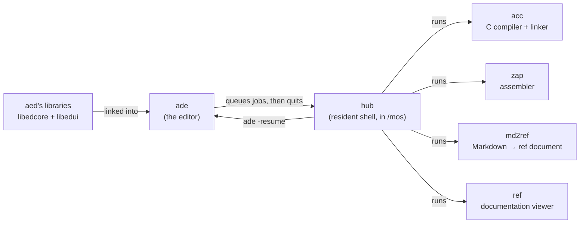
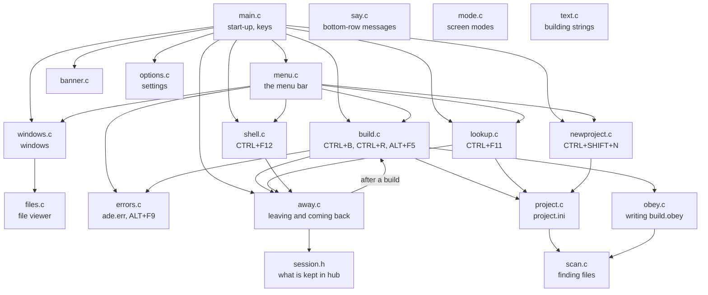
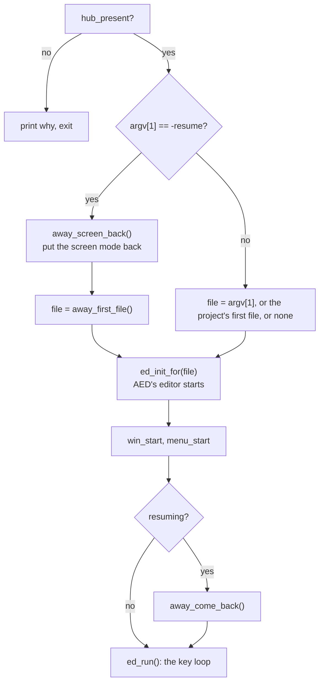
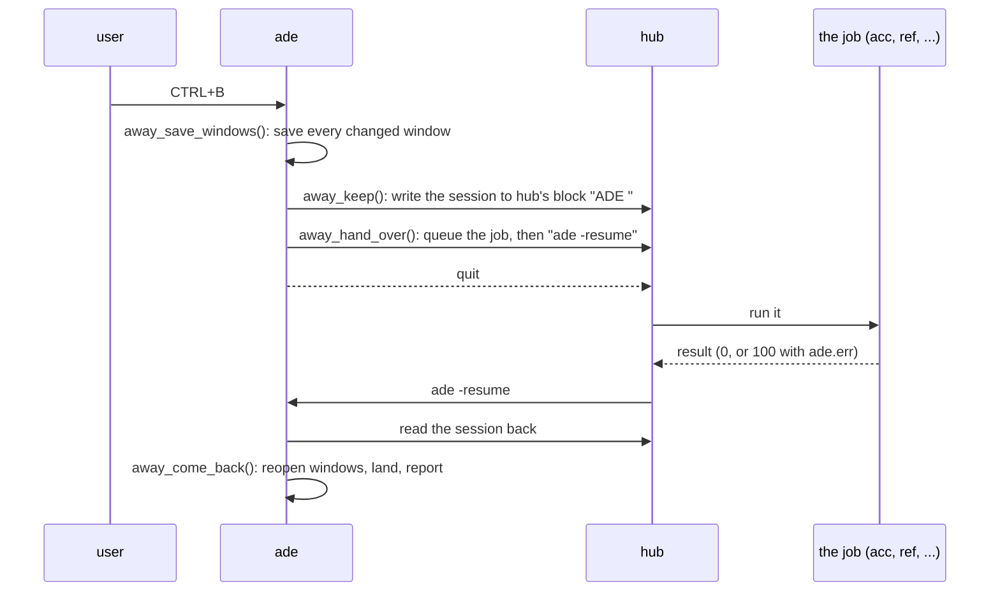
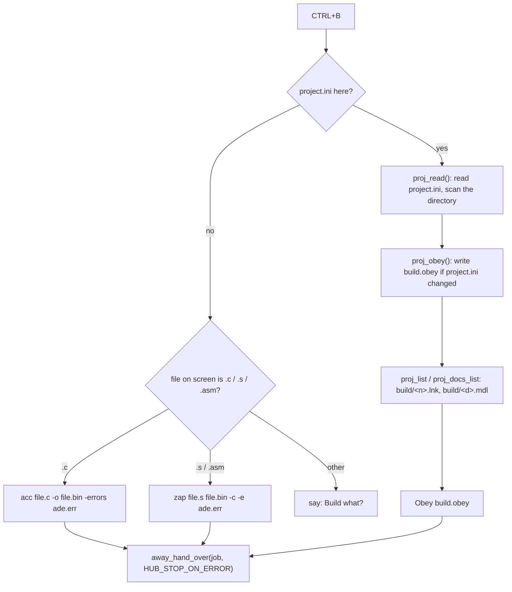
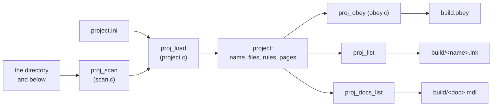
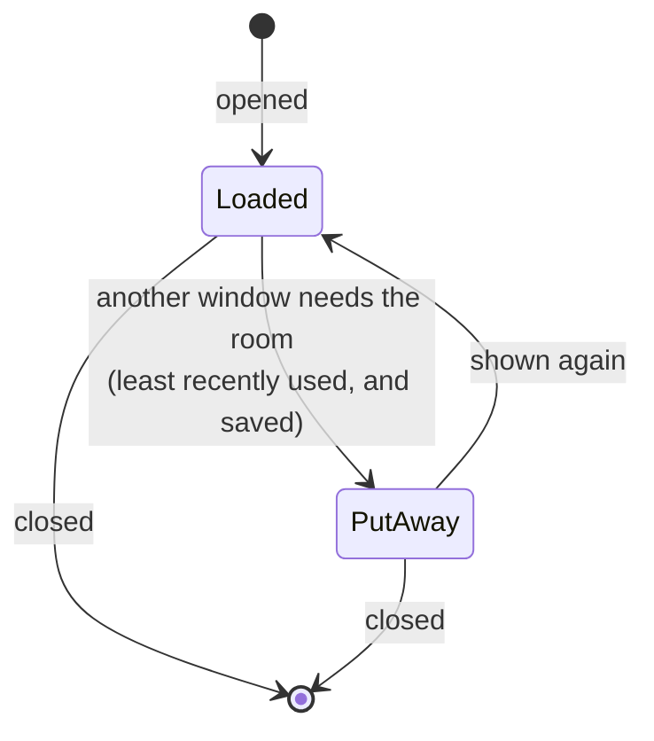
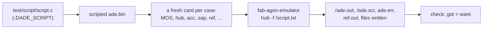

# How ADE works

ADE is a development environment for the Agon. It is AED's editor with
menus, windows, projects, and a way to build, run and look things up without
leaving it. This document explains how the pieces fit, with links into the
code. Start with [the big picture](#the-big-picture), then read whichever
part you are about to change.

* [The big picture](#the-big-picture)
* [The source files](#the-source-files)
* [Starting up](#starting-up)
* [Leaving for hub and coming back](#leaving-for-hub-and-coming-back)
* [Building](#building)
* [Projects](#projects)
* [Errors](#errors)
* [Looking things up in ref](#looking-things-up-in-ref)
* [Windows](#windows)
* [Opening files](#opening-files)
* [The screen](#the-screen)
* [Memory](#memory)
* [Tests](#tests)

## The big picture

The Agon has 512 KB of RAM and every program loads at the same address, so
only one runs at a time. ADE can't stay in memory while acc compiles. Instead
it hands the work to **hub**, a resident shell that stays in memory and runs
programs on others' behalf. ADE writes down what it had open, asks hub to run
the job and then start ADE again, and quits. When ADE comes back it reopens
everything and lands on the result.



| Piece | What it is | Where |
|---|---|---|
| ADE | this repository | `/bin/ade.bin` |
| aed's libraries | the editor: text, screen, keys, settings | linked in, pinned in [`aed-libs.pin`](../aed-libs.pin) |
| hub | runs jobs, keeps ADE's session between runs | `/mos/hub.bin` |
| acc | C compiler and linker, with its C library | `/bin/acc.bin`, `/lib/acc` |
| zap | assembler | `/bin/zap.bin` |
| ref, md2ref | documentation viewer, and its compiler | `/bin/ref.bin`, `/bin/md2ref.bin` |
| documents | acc's C library, the Agon's own docs | `/config/ref/docs/acc.dat`, `mos.dat` |

## The source files

Each file does one thing, and its header says what it offers.



| File | Does |
|---|---|
| [`main.c`](../src/main.c) | starts ADE, and binds every key |
| [`menu.c`](../src/menu.c) | the menu bar under the title, and its pull-down menus |
| [`windows.c`](../src/windows.c) | up to nine windows, three of them loaded |
| [`files.c`](../src/files.c) | the file viewer behind CTRL+O and CTRL+SHIFT+O |
| [`away.c`](../src/away.c) | saving, handing a job to hub, and coming back |
| [`session.h`](../src/session.h) | what ADE writes down in hub's memory while it is gone |
| [`build.c`](../src/build.c) | building and running, and what a build says afterwards |
| [`errors.c`](../src/errors.c) | reading `ade.err`, landing on an error, the error list |
| [`lookup.c`](../src/lookup.c) | looking the word at the cursor up in ref |
| [`shell.c`](../src/shell.c) | dropping to hub's prompt |
| [`newproject.c`](../src/newproject.c) | making a project, or renaming one |
| [`project.c`](../src/project.c) | reading and writing `project.ini` |
| [`scan.c`](../src/scan.c) | finding a project's sources and pages |
| [`obey.c`](../src/obey.c) | writing `build.obey` and the lists it reads |
| [`say.c`](../src/say.c) | messages on the bottom row |
| [`mode.c`](../src/mode.c) | changing screen mode, and waiting for the VDP |
| [`options.c`](../src/options.c) | settings, in `/config/ade.ini` |
| [`banner.c`](../src/banner.c) | the banner shown with no file |
| [`text.c`](../src/text.c) | building strings without `printf` |

The editor itself -- the text buffer, painting, editing keys, undo, find,
syntax colouring, settings -- is AED's, from `libedcore` and `libedui`. ADE
gives the editor its own keys ([`main.c`](../src/main.c)'s `ADE_BINDINGS`,
checked before AED's), a title, a banner, and its settings file.

## Starting up

[`main`](../src/main.c) is short:



With no file to open and no project, the editor shows the
[banner](../src/banner.c), "Press F10 to access the menus".

## Leaving for hub and coming back

This is the core of ADE, in [`away.c`](../src/away.c). Building, running,
looking up and the shell all use it.



The session ([`session.h`](../src/session.h)) records:
- what kind of job it was (build, shell or ref);
- the screen mode;
- each window's file and cursor, and which one was on screen;
- for a build, whether a program ran after it and its name;
- for ref, the word and the documents asked.

It starts with a magic and its own size. A session left by a different
ADE build, laid out differently, is ignored rather than misread.

Coming back, [`away_come_back`](../src/away.c):
1. Puts window 1's file in (the editor started on it), and the rest back
   *put away* (see [Windows](#windows)), so only one file is loaded.
2. Works out where to land: the window that was on screen, or, after a
   failed build, the first error ([`build_landing`](../src/build.c)).
3. Places every other window without drawing it, then shows the landing one.
   A paint takes about a fifth of a second, so there's only one.
4. Asks the job's module what to say: [`build_report`](../src/build.c),
   [`shell_report`](../src/shell.c) or [`lookup_report`](../src/lookup.c).

A program can change the screen mode. ADE puts its own back with
[`mode_set`](../src/mode.c), which waits for the VDP to confirm the change.
On real hardware MOS learns the new size late, and laying out sooner would
draw for the old mode.

## Building

[`build.c`](../src/build.c) decides what to build:



CTRL+R queues the program after the build, as a *user program*: hub gives it
the prompt's screen, and waits for a key after it. hub skips the program when
a build step fails. ALT+F5 shows the screen the program left, which hub
captured into a VDP buffer.

## Projects

A directory with a `project.ini` is a project. The file names the program and
can override the rules; [`project.h`](../src/project.h) documents every
setting.



- **Sources.** With no `files =` line, the project is every `.c`, `.s` and
  `.asm` in its directory and four levels below, by path, skipping hidden
  directories and `build/`, `bin/` and `ref-doc/`
  ([`scan.c`](../src/scan.c)).
- **Pages.** Every `.md` file, found the same way, is documentation.
- **The build** is `build.obey`, run by MOS's Obey as one hub job, so it isn't
  limited to hub's eight jobs. Its lines are: a compile per file into
  `build/<file>.o`, the link into `bin/<name>.bin`, and md2ref into
  `ref-doc/<doc>.dat`. Obey stops at the first that fails.
- **Line length.** MOS cuts a command line at about 255 characters. So the
  link reads its objects from `build/<name>.lnk` (`acc @file`), and md2ref
  reads its pages from `build/<doc>.mdl`.
- **build.obey is written again only when it would change.** Its first line
  holds a checksum of `project.ini`, ADE's default rules, the files found
  and the error file's name, so a hand edit to it lasts until one of those
  changes.

A whole `project` is about 5 KB, so ADE reads it into the heap only for a
build or a rename ([`proj_read`](../src/project.c)). It keeps only the
program's name, first file and document's name between builds
(`proj_here_*`).

## Errors

acc, zap and md2ref write errors as `file:line:column: error: text` to
`ade.err` in the project's directory, and exit with 100. md2ref gives a line
and no column. [`errors.c`](../src/errors.c) reads up to sixteen. On a failed
build ADE lands on the first one, opening its file if needed, and shows it as
`line:col: text`, since the footer already names the file. With more than
one, it shows the list, which ALT+F9 brings back.

## Looking things up in ref

[`lookup.c`](../src/lookup.c) takes the word at the cursor, or the
selection, and runs ref through hub:

```
ref ref-doc/<doc>.dat,acc -k <word>     in a .c or .h file, in a project with docs
ref acc -k <word>                       in a .c or .h file
ref mos -k <word>                       anywhere else
ref mos                                 CTRL+ALT+F11: the contents
```

ref tries the documents in turn and skips one that is missing. It exits 0
when it showed something and 100 when nothing matched. A missing installed
document also gives 100, so ADE checks for `/config/ref/docs/<doc>.dat`
first and says which is missing.

## Windows

[`windows.c`](../src/windows.c) keeps up to nine windows. The editor has room
for three loaded documents, each with 40 KB of text and its undo history:
the editor's own and two of ADE's.



A window put away keeps its file name and cursor but loses its undo
history. Only a saved window can be put away: if none of the loaded ones is
saved, ADE asks to save the one used longest ago. A window whose path is 64
characters or longer stays loaded, because it couldn't be named again.

## Opening files

[`files.c`](../src/files.c) is the viewer behind CTRL+O and CTRL+SHIFT+O. It
lists the directory ADE started in, directories first and then files. Typing
narrows the list, and a name that matches nothing opens as a new file. F7, or
the `[ New directory ]` row, makes a directory. It never goes above the
directory ADE started in. While open, it borrows about 5 KB from the heap for
the listing, and gives it back on closing.

## The screen

The title sits on the top row, with the menu bar under it
([`menu.c`](../src/menu.c)), both drawn in the footer's colours. The
document fills the middle, and AED's footer is at the bottom. The right end
of the menu bar shows the last build's status, the project's name, and the
windows, with the one on screen in brackets. Messages and questions use the
bottom row ([`say.c`](../src/say.c)), cut to fit, because text written past
the row's end would scroll the whole screen.

## Memory

ADE's code and static data, the heap and the stack all share one region,
with the heap and stack growing toward each other. No function's stack frame
may exceed 128 bytes, the reach of an `(ix+d)` offset, and
[`test/frames.sh`](../test/frames.sh) checks that. Large buffers are
`static`, or borrowed from the heap only while they're needed: the project,
the file viewer's listing. With three large files open, ADE has about 43 KB
left, and the tests fail below 40 KB.

## Tests

[`test/run.sh`](../test/run.sh) builds ADE and checks it, mostly on
fab-agon-emulator:



The scripted ADE ([`test/script/script.c`](../test/script/script.c)) takes
its keys from a list chosen by the file it is started on, not from the
keyboard. It writes what it did and what was on screen to files the checks
read back. Each case runs on a fresh copy of a card, four at a time. Every
check is meant to fail when the code it covers is broken: each change was
tested by breaking that line and watching the check fail.
